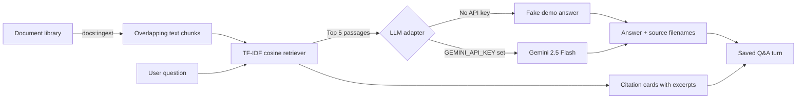

# PDF Q&A Studio

PDF Q&A Studio is a recruiter-ready document Q&A desk for **Northwind Desk**, a fictional support workspace. Ask questions across six operational manuals and get an answer grounded in retrieved passages, with source filenames and excerpts shown alongside it.

The v1 library contains seeded plain-text manuals displayed with `.pdf` filenames for the product demo. It does not parse uploaded or binary PDFs.

## The AI design



1. **Library:** each `LibraryDoc` stores a title, display filename, and source text.
2. **Chunking:** `php artisan docs:ingest` rebuilds `DocChunk` records at about 500 characters with a 50-character overlap.
3. **Retrieval:** a pure-PHP TF-IDF cosine retriever ranks matching chunks and returns at most five. There is no Redis or vector database.
4. **Answering:** `App\Services\Llm\LlmClient` separates generation from retrieval. Without a key, `FakeLlmClient` gives a deterministic extractive demo answer. With a key, `GeminiLlmClient` calls Gemini with a 12-second timeout. Provider failures fall back to the retrieved text instead of surfacing an unhandled error.
5. **Citations:** the response includes the source filename list, and the UI displays the matching manual and excerpt. `QaTurn` stores the question, final answer, and retrieved chunk IDs.

The Gemini prompt treats retrieved text as untrusted source material and asks the model to use only the supplied excerpts. For important decisions, verify the cited passage directly.

## Run locally

Requirements: PHP 8.3+, Composer, Node.js 22+, and SQLite support for PHP.

```bash
composer setup
php artisan migrate --seed
```

Start the app in one terminal:

```bash
php artisan serve
```

Open [http://localhost:8000](http://localhost:8000). `composer setup` installs dependencies, creates the local `.env`, generates an app key, migrates the database, and builds the Vue assets. Seeding loads the six fictional manuals and indexes them, so no demo credentials or external API key are needed.

To re-create the chunks after editing document text, run:

```bash
php artisan docs:ingest
```

### Optional Gemini answers

Without `GEMINI_API_KEY`, the desk runs in deterministic demo mode using the built-in fake client. To use Gemini, set these values in `.env` and restart the app:

```dotenv
GEMINI_API_KEY=your-google-ai-studio-key
GEMINI_MODEL=gemini-2.5-flash
```

The API key stays on the server. Each Gemini request has a 12-second timeout; if the provider is unavailable, the desk returns a retrieval-only answer with citations.

## Test the AI behavior

```bash
php artisan test
```

Pest feature tests prove the important behavior without making external model calls:

- TF-IDF ranks `refunds-manual.pdf` first for a refund question.
- The HTTP Q&A flow uses `FakeLlmClient`, returns a source citation, and persists the retrieved chunk IDs.
- `docs:ingest` creates ordered 500-character chunks with a 50-character overlap.
- A model exception degrades to a cited retrieval-only response instead of an HTTP 500.

Frontend checks and production build:

```bash
npm run check
npm run types:check
npm run build
```

Laravel formatting and static analysis:

```bash
composer lint:check
composer types:check
```

## Stack

- Laravel 13, PHP 8.3+, SQLite
- Vue 3, Inertia.js, Tailwind CSS
- Pest, TF-IDF retrieval, optional Gemini API

## Sample library

The fictional Northwind Desk library includes onboarding, refunds and billing, support SLAs, password resets, incident severity, and data retention. It contains no real client information or customer data.
